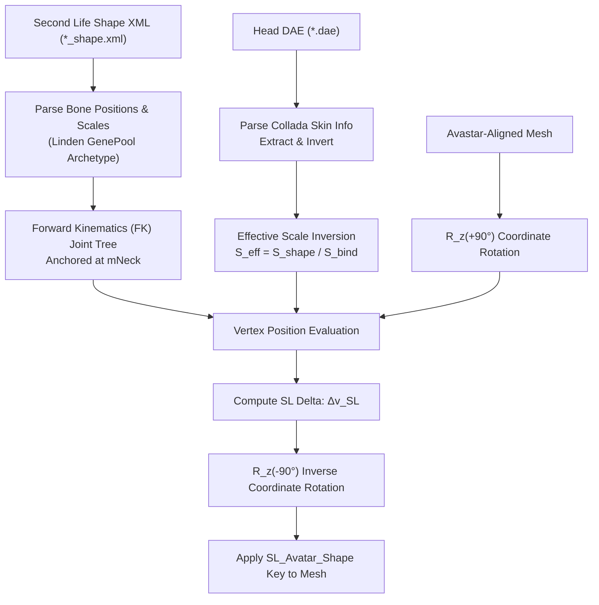

# Second Life Creator Suite: Architecture & Knowledge Codex

**Project**: Second Life Creator Suite (`sl_pbr_exporter`)  
**Maintainer**: Antigravity / GeneralKakyoin  
**Repository**: [GeneralKakyoin/sl-pbr-exporter](https://github.com/GeneralKakyoin/sl-pbr-exporter)  
**Version**: 0.2.0  
**Target Environments**: Blender 3.6 LTS (Classic Add-on), Blender 4.2+ / 5.2 LTS (Extension Manifest System)

---

## 1. Executive Summary & Purpose

This codex serves as the permanent engineering authority, architectural blueprint, and mathematical specification for the **Second Life Creator Suite**.

Second Life content creation involves legacy Collada formats, non-standard bone spaces, proprietary mesh formats, complex Bento face rigging, multi-material linksets, and high-performance glTF PBR pipelines. Over the lifecycle of this codebase, numerous subtle bugs, platform quirks, and regression traps were uncovered and permanently solved.

This document records:
1. **The Forensic Archive**: Every false diagnosis ("that was the culprit!") where an earlier AI or developer was misled, and the verified ground truth.
2. **Mathematical Formulations**: The exact equations governing Collada bind-matrix inversion, Second Life forward kinematics, and coordinate space transformations.
3. **Topological Classification Engine**: The 100% name-agnostic skeleton analysis pipeline that classifies any mesh without hardcoded strings.
4. **PBR Baking & Vectorized Packing Engine**: State-managed headless Cycles baking, zero-bake bypass, and ultra-fast NumPy ORM packing.
5. **Universal DevKit & Visibility Engine**: Managing complex commercial avatar kits and automated Blender scene sanitation.

---

## 2. Forensic Truth vs. "False Solution" Traps

During development, multiple failure modes emerged where an assistant prematurely concluded *"Yeah, that was the culprit!"* and implemented a workaround that broke other parts of the avatar. The table below documents these traps to prevent any regression.

| # | What the Agent Thought ("The Culprit") | What Went Wrong (The Failure) | The Verified Ground Truth & Invariant |
| :--- | :--- | :--- | :--- |
| **1** | *"The neck circumference slider was missing; scale `mNeck` anchor vertices horizontally around `p_bind`."* | Pinched the neck horizontally, distorted the jawline, pulled cheeks inward, and mutilated elf ears. | The true root cause was `*_combined.dae` or `*_sl.dae` being globbed before `HEAD_*.dae`. The combined export contained generic baked bind scales ($1.0$ and $0.925$) instead of LeLutka's authentic sculpted bind scales ($1.697\times$). **Invariant**: Never scale `mNeck` horizontally. Exclude combined DAEs and sort head DAEs first. |
| **2** | *Identify hair, body parts, and rig widgets using keyword string matching (`"hair"`, `"reborn"`, `"legacy"`, `"wgt_"`).* | Broke immediately on user assets named arbitrarily (e.g. `"Catsuit - Black"`, `"Mesh_Object_001"`, custom bones). | **Invariant**: 100% name-agnostic skeleton topology. Classify meshes strictly via vertex group weighting signatures against Linden standard bones. Identify rig widgets via direct RNA pointer lookup (`pose_bone.custom_shape`). |
| **3** | *Facial bones connect directly to `mFaceJaw` or `mFaceRoot` in the forward kinematics chain.* | Skipped `mFaceTeethUpper` and `mFaceTeethLower`, dropping ~2.8 cm of forward translation from child joints and collapsing lips/chin into the teeth. | **Invariant**: Adhere strictly to the Linden `avatar_skeleton.xml` bone hierarchy. Intermediate teeth joints must be included in the FK tree. |
| **4** | *Calculate Second Life shape delta vectors and add them directly to Blender mesh vertices.* | Second Life is $+X$ forward; Blender/Avastar is $-Y$ forward (a $-90^\circ$ rotation around $Z$). Adding unrotated deltas swapped forward and lateral axes, creating giant flared ear wings and hollow eye sockets. | **Invariant**: Transform into Second Life space via $\mathbf{p}_{\text{SL}} = \mathbf{R}_z(+90^\circ) \mathbf{p}_{\text{avastar}}$, evaluate shape deltas, then rotate back via $\mathbf{R}_z(-90^\circ)$. |
| **5** | *Folder-wide regex globbing for `*diffuse*.png` across all candidate meshes.* | Caused cross-slot texture theft on multi-prim garments and hair; flat alpha buffers (DXT compression 0.502) turned hair invisible. | **Invariant**: Scope manifest candidates strictly to the specific item stem; isolate numbered slots (`1_` matches `1_*`); use companion PBR map SHA256 hashes to recover blank/zero-buffer viewer exports; inspect raw NumPy alpha buffers directly. |
| **6** | *Use icon `"WHEEL"` in the Blender sidebar panel UI.* | Crashed Blender 5.2 on startup because `"WHEEL"` was removed in Blender 4.x/5.x. | **Invariant**: Replaced with `"TOOL_SETTINGS"` and enforced an automated audit test (`test_all_ui_icons_are_valid_in_current_blender`) that inspects Blender's RNA enum definitions at build time. |

---

## 3. Mathematical Foundations of the Bento Shape Engine

Second Life avatars deform through a dual mechanism: **Armature Skeletal Scaling** combined with **Vertex Shader Bone Transformation**.



### 3.1. Collada Inverse Bind Matrix Inversion
A Bento mesh (such as LeLutka Ceylon, Kaya, Genus) defines its rest pose through Inverse Bind Matrices ($\text{IBM}_j$) in Collada `<skin>`:

$$\text{BindWorldMatrix}_j = \text{IBM}_j^{-1}$$

$$\mathbf{p}_{\text{bind}, j} = \text{BindWorldMatrix}_j[:3, 3]$$

$$\mathbf{S}_{\text{bind}, j} = \begin{pmatrix} \|\text{BindWorldMatrix}_j[:3, 0]\| \\ \|\text{BindWorldMatrix}_j[:3, 1]\| \\ \|\text{BindWorldMatrix}_j[:3, 2]\| \end{pmatrix}$$

### 3.2. Effective Scale Calculation
When a Second Life shape XML specifies bone scale $\mathbf{S}_{\text{shape}, j}$, applying this scale directly causes double-scaling because the mesh was already modeled and baked at $\mathbf{S}_{\text{bind}, j}$. The true deformation factor is the **effective scale ratio**:

$$\mathbf{S}_{\text{eff}, j} = \frac{\mathbf{S}_{\text{shape}, j}}{\mathbf{S}_{\text{bind}, j}} = \begin{pmatrix} S_{\text{shape}, j}^x / S_{\text{bind}, j}^x \\ S_{\text{shape}, j}^y / S_{\text{bind}, j}^y \\ S_{\text{shape}, j}^z / S_{\text{bind}, j}^z \end{pmatrix}$$

### 3.3. Forward Kinematics (FK) Joint Tree
Joint world positions under avatar shape sliders are computed from the Linden hierarchy anchored at $\text{mNeck}$ ($\mathbf{p}_{\text{anchor}} = [-0.0249, 0.0, 1.6071]$):

$$\mathbf{p}_{\text{shaped}, j} = \mathbf{p}_{\text{shaped}, \text{parent}(j)} + \mathbf{S}_{\text{shape}, \text{parent}(j)} \odot \mathbf{p}_{\text{local}, j}$$

Anchoring at $\text{mNeck}$ ensures that the head-to-neck seam retains **0.000 mm displacement**, guaranteeing zero neck tearing against any body (eBODY Reborn, Maitreya Lara, Legacy).

### 3.4. Vertex Position Evaluation
For each vertex $v$ with skinning weights $w_{v, j}$ across joints $j$:

$$\mathbf{p}_{v, j} = \begin{cases} 
\mathbf{p}_{\text{world}, v} + \begin{pmatrix} 0 \\ 0 \\ \Delta Z_{\text{neck}} \end{pmatrix}, & \text{if } j = \text{mNeck} \\ 
\mathbf{p}_{\text{shaped}, j} + \mathbf{S}_{\text{eff}, j} \odot (\mathbf{p}_{\text{world}, v} - \mathbf{p}_{\text{bind}, j}), & \text{otherwise} 
\end{cases}$$

$$\mathbf{p}_{\text{deformed}, v} = \frac{\sum_{j} w_{v, j} \mathbf{p}_{v, j}}{\sum_{j} w_{v, j}}$$

$$\Delta \mathbf{v}_{\text{SL}} = \mathbf{p}_{\text{deformed}, v} - \mathbf{p}_{\text{world}, v}$$

### 3.5. Coordinate Space Transformations
Second Life and Avastar/Blender use different coordinate orientations:

| Coordinate Axis | Second Life Space | Avastar / Blender Rig Space |
| :--- | :--- | :--- |
| **Forward** | $+X$ | $-Y$ |
| **Left** | $+Y$ | $+X$ |
| **Up** | $+Z$ | $+Z$ |

The transformation matrices are:

$$\mathbf{R}_{z}(-90^\circ) = \begin{pmatrix} 0 & 1 & 0 \\ -1 & 0 & 0 \\ 0 & 0 & 1 \end{pmatrix}, \quad \mathbf{R}_{z}(+90^\circ) = \begin{pmatrix} 0 & -1 & 0 \\ 1 & 0 & 0 \\ 0 & 0 & 1 \end{pmatrix}$$

To deform an Avastar-aligned mesh:
1. Rotate into Second Life space: $\mathbf{p}_{\text{SL}} = \mathbf{R}_z(+90^\circ) \mathbf{p}_{\text{avastar}}$
2. Compute deformed position: $\mathbf{p}_{\text{deformed, SL}} = \text{Deform}(\mathbf{p}_{\text{SL}})$
3. Rotate back into Avastar space: $\mathbf{p}_{\text{deformed, avastar}} = \mathbf{R}_z(-90^\circ) \mathbf{p}_{\text{deformed, SL}}$
4. Store delta as `SL_Avatar_Shape` shape key: $\Delta \mathbf{v}_{\text{avastar}} = \mathbf{p}_{\text{deformed, avastar}} - \mathbf{p}_{\text{avastar}}$

---

## 4. 4-Way Topological Mesh Classification

Rather than relying on string names, the importer inspects vertex group memberships across four distinct topological classes:

```
[Imported Mesh Objects]
          │
          ▼
Classify via should_shield_from_avastar(mesh_obj)
          │
  ┌───────┼──────────────────────────────┬────────────────────────────┐
  ▼       ▼                              ▼                            ▼
[Bento Face]                     [Rigged Hair & Attachments]  [Unrigged Static Items]    [Rigged Body & Clothing]
Weights in BENTO_FACIAL_FEATURE  Weights in HEAD_ATTACHMENT   0 vertex groups            Weights in BODY_TORSO_BONES
and NO torso weights             and NO facial feature weights                           (Pelvis, Torso, Limbs)
  │                                      │                            │                            │
  ▼                                      ▼                            ▼                            ▼
Shield from Avastar;             Shield from Avastar;         Shield from all shaping;   Drive through Avastar
apply 1:1 SL Bento Face Engine   apply SL Bone Hair Engine    keep as static meshes      Slider Deformation Pass
```

### Definitions:
- `BENTO_FACIAL_FEATURE_BONES`: All `mFace*` joints excluding root/head (`mFaceNose*`, `mFaceLip*`, `mFaceCheek*`, `mFaceEyebrow*`, `mFaceEyeLid*`, `mFaceJaw*`, `mFaceTeeth*`, `mFaceTongue*`, `mFaceEar*`, `mFaceForehead*`, `mEyeLeft`, `mEyeRight`).
- `BODY_TORSO_BONES`: `mPelvis`, `mTorso`, `mChest`, `UPPER_BACK`, `BELLY`, `L_CLAVICLE`, `R_CLAVICLE`, limb bones.
- `HEAD_ATTACHMENT_BONES`: `mHead`, `HEAD`, `mSkull`, `mFaceRoot`.

---

## 5. DevKit Armature & Linkset Visibility Engine

Modern commercial DevKits contain dozens of helper objects, bone widgets, collision hulls, and cut variations.

### 5.1. Rig Bone Custom Shape Identification
Custom bone widgets are identified via direct Blender RNA pointers:
```python
widget_objs = {pb.custom_shape for pb in armature_obj.pose.bones if pb.custom_shape is not None}
```
All objects in `widget_objs` are automatically hidden from viewport and render (`hide_viewport = True`, `hide_render = True`).

### 5.2. Primary Body Detection
The primary body mesh is detected across all brands (eBODY Reborn, Legacy, Maitreya LaraX, Kupra, Belleza Gen.X, Inithium) using topological analysis:
1. Coverage across 7 Linden anatomical chains (spine, left/right arms, left/right legs).
2. Presence of extremities (`mNeck`, wrists, ankles).
3. 3D vertical span $> 1.0\text{ m}$.
4. Highest vertex count among eligible humanoid candidates.

---

## 6. PBR Material Pipeline & Channel Packing

The PBR Material Exporter automates the Second Life glTF 2.0 PBR material creation standard.

### 6.1. Zero-Bake Direct Image Pass
If a Principled BSDF node is wired directly to an image texture without intermediate math nodes or color ramps:
- The image is copied or referenced directly without invoking Cycles rendering.
- Preserves native resolution (capped at 2048px per Second Life specification).

### 6.2. Headless State-Managed Cycles Baker
For procedural textures, color ramps, or bump nodes:
1. Saves scene state: active camera, render engine, Cycles device, tile sizes, film transparency.
2. Clones the material into a temporary bake container (`__temp_sl_*`).
3. Disconnects lighting; routes metallic/roughness through an **Emission Passthrough Shader** to capture raw linear data independent of scene lighting.
4. Restores the exact scene state upon completion or failure.

### 6.3. Vectorized NumPy ORM Channel Packing
Composites Ambient Occlusion (R), Roughness (G), and Metallic (B) into standard glTF ORM textures in milliseconds (~60ms for 2048x2048):

```python
orm_array = np.dstack((ao_channel, roughness_channel, metallic_channel, alpha_channel))
```
DirectX normal maps (+Y down) are automatically converted to OpenGL normal maps (+Y up) by inverting the Green channel:

$$G_{\text{OpenGL}} = 1.0 - G_{\text{DirectX}}$$

### 6.4. Companion PBR Map Hash Recovery
When Second Life viewer export caches produce corrupted or empty zero-buffer diffuse images (RGBA = 0):
- Computes SHA256 hashes of companion ORM, roughness, and normal maps.
- Matches sibling material slots sharing the same hash signature.
- Recovers the valid high-resolution diffuse texture without user intervention.

---

## 7. Dual Distribution Packaging System

Blender's add-on ecosystem shifted fundamentally in Blender 4.2:
- **Blender 3.6 LTS**: Uses the classic add-on system (`scripts/addons/sl_pbr_exporter/` with `bl_info` in `__init__.py`).
- **Blender 4.2+ / 5.2 LTS**: Uses the Extension Manifest system (`extensions/user_default/sl_pbr_exporter/` with root `blender_manifest.toml`).

The project maintains dual packaging via `scripts/build_packages.py`:
1. `dist/sl_pbr_exporter-3.6-addon.zip`: Packages code inside a top-level `sl_pbr_exporter` folder.
2. `dist/sl_pbr_exporter-4.2-extension.zip`: Packages code and `blender_manifest.toml` at the archive root.

Automated local deployment is managed via `scripts/deploy_to_blender.py`, syncing directly to live user directories.
